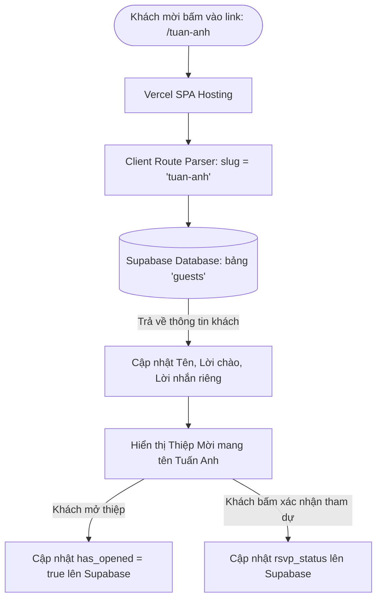

# KẾ HOẠCH TRIỂN KHAI: THIỆP MỜI CÁ NHÂN HÓA VỚI SUPABASE & VERCEL

> **Mục tiêu:** Mỗi khách mời sẽ nhận được một đường link URL riêng biệt (ví dụ: `https://thiepmoi.vercel.app/nguyen-van-a` hoặc `https://thiepmoi.vercel.app/1`). Khi mở link, thiệp mời sẽ hiển thị chính xác tên, cách xưng hô và lời nhắn dành riêng cho người đó, đồng thời ghi nhận lại thời gian họ đã mở thiệp và phản hồi RSVP về database Supabase.

---

## 1. Kiến trúc hệ thống (System Architecture)



- **Frontend:** React + Vite + TypeScript (đang chạy hiện tại).
- **Routing:** Trích xuất định danh (`slug` hoặc `id`) trực tiếp từ URL path hoặc Query parameter mà không cần cài thêm thư viện router nặng nề.
- **Database:** Supabase PostgreSQL (gói Free tier không giới hạn thời gian, hỗ trợ Realtime).
- **Hosting & CI/CD:** Vercel (kết nối GitHub repo, tự động build và deploy mỗi khi push code).

---

## 2. Thiết kế Database trên Supabase

### Bảng `guests`
Tạo bảng chứa danh sách bạn bè được mời trong SQL Editor của Supabase:

```sql
CREATE TABLE guests (
    id SERIAL PRIMARY KEY,
    slug VARCHAR(100) UNIQUE NOT NULL,      -- Định danh trên URL: 'tuan-anh', 'ban-linh', '1'
    name VARCHAR(255) NOT NULL,             -- Tên khách: 'Nguyễn Văn Tuấn'
    greeting VARCHAR(255) DEFAULT 'Gửi bạn thân yêu', -- Cách xưng hô riêng: 'Gửi anh Tuấn', 'Gửi em Linh'
    custom_message TEXT,                    -- (Tùy chọn) Lời nhắn nhủ riêng cho người này
    has_opened BOOLEAN DEFAULT FALSE,       -- Khách đã mở thiệp hay chưa
    opened_at TIMESTAMP WITH TIME ZONE,     -- Thời gian khách mở thiệp
    rsvp_status VARCHAR(50) DEFAULT 'pending', -- 'attending' (Tham gia) | 'declined' (Bận) | 'pending'
    rsvp_note TEXT,                         -- Lời chúc bạn bè gửi lại
    created_at TIMESTAMP WITH TIME ZONE DEFAULT NOW()
);

-- Kích hoạt Row Level Security (RLS)
ALTER TABLE guests ENABLE ROW LEVEL SECURITY;

-- Cho phép khách đọc thông tin thiệp của chính mình qua slug
CREATE POLICY "Public read guest by slug" 
ON guests FOR SELECT 
USING (true);

-- Cho phép khách cập nhật trạng thái mở thiệp và RSVP
CREATE POLICY "Public update guest attendance" 
ON guests FOR UPDATE 
USING (true);
```

---

## 3. Các bước triển khai chi tiết trên Frontend

### Bước 1: Cài đặt thư viện Supabase Client
Chạy lệnh cài đặt SDK chính thức của Supabase:
```bash
npm install @supabase/supabase-js
```

### Bước 2: Thiết lập file môi trường (.env)
Tạo file `.env.local` lưu thông tin kết nối Supabase (các biến có tiền tố `VITE_` để Vite đọc được):
```env
VITE_SUPABASE_URL=https://your-project.supabase.co
VITE_SUPABASE_ANON_KEY=your-anon-public-key
```

### Bước 3: Tạo Module kết nối Supabase (`src/lib/supabase.ts`)
Khởi tạo instance Supabase client dùng chung toàn ứng dụng.

### Bước 4: Tạo Hook lấy dữ liệu khách mời (`src/hooks/useGuest.ts`)
- Lấy `slug` từ `window.location.pathname` (ví dụ: URL `https://domain/1` -> lấy được `slug = "1"`).
- Gọi Supabase lấy thông tin khách tương ứng:
  - **Nếu tìm thấy:** Trả về `{ name, greeting, custom_message, ... }`.
  - **Nếu không tìm thấy hoặc link gốc (`/`):** Tự động fallback về thông tin mặc định trong `invitation.config.ts`.
- Cung cấp hàm `markOpened()` để tự động cập nhật `has_opened = true` và `opened_at = new Date()` khi khách nhấn mở thiệp.
- Cung cấp hàm `submitRSVP(status, note)` để lưu phản hồi khi khách chọn "Sẽ tham gia" hoặc "Gửi lời chúc".

### Bước 5: Kết nối dữ liệu vào giao diện
1. **Thiệp mở đầu (`EnvelopeScene.tsx`):**
   - Thay thế dòng greeting bằng `guest.greeting` (ví dụ: *"Gửi anh Tuấn thân yêu,"*).
   - Khi bấm mở thiệp thành công, kích hoạt `markOpened()`.
2. **Nội dung chính (`InvitationSection.tsx`):**
   - Hiển thị tên người nhận ở phần đầu thư.
   - Thêm nút tương tác RSVP ("Mình sẽ đến chung vui 💕" / "Rất tiếc mình bận mất rồi").

---

## 4. Cấu hình Vercel để hỗ trợ URL dạng `https://thiepmoi/1`

Vì đây là Single Page Application (SPA), nếu người dùng truy cập trực tiếp vào `https://thiepmoi/1` hoặc nhấn F5 tải lại trang, Vercel sẽ tìm file `/1/index.html` và báo lỗi **404 Not Found**.

**Giải pháp:** Tạo file `vercel.json` ở thư mục gốc:
```json
{
  "rewrites": [
    {
      "source": "/(.*)",
      "destination": "/index.html"
    }
  ]
}
```
*Tất cả mọi đường dẫn (như `/1`, `/tuan-anh`, `/linh-dan`) sẽ tự động được điều hướng về `index.html` để React đọc URL và nạp đúng tên bạn bè.*

---

## 5. Quy trình Deploy lên Vercel (Từng bước)

1. **Đẩy code lên GitHub:**
   - Khởi tạo Git repo và push lên GitHub cá nhân (Private hoặc Public).
2. **Đăng nhập Vercel:**
   - Vào vercel.com -> Đăng nhập bằng tài khoản GitHub.
   - Chọn **Add New Project** -> Chọn repository thiệp mời.
3. **Cấu hình Environment Variables trên Vercel:**
   - Trong phần **Environment Variables**, thêm 2 biến:
     - `VITE_SUPABASE_URL`
     - `VITE_SUPABASE_ANON_KEY`
4. **Bấm "Deploy":**
   - Vercel sẽ tự động build trong khoảng 30 - 60 giây và cấp cho bạn tên miền miễn phí dạng `https://letotnghiepcua-ngoc-tram.vercel.app/`.
   - Bạn có thể gắn tên miền riêng (Custom Domain) tùy ý hoàn toàn miễn phí.

---

## 6. Tiện ích quản lý danh sách & Tạo link gửi bạn bè

Khi chuẩn bị gửi thiệp, bạn chỉ cần nhập danh sách bạn bè vào Supabase Table Editor hoặc chạy 1 câu lệnh SQL mẫu:

```sql
INSERT INTO guests (slug, name, greeting) VALUES
('1', 'Nguyễn Văn Tuấn', 'Gửi anh Tuấn thân yêu,'),
('2', 'Trần Thị Lan', 'Gửi chị Lan yêu quý,'),
('linh-dan', 'Khánh Linh', 'Gửi cô bạn thân Khánh Linh,');
```

Sau đó, bạn có thể copy link tương ứng để gửi qua tin nhắn Zalo / Messenger:
- `https://letotnghiepcua-ngoc-tram.vercel.app/?to=1` -> Anh Tuấn nhận được thiệp riêng cho mình.
- `https://letotnghiepcua-ngoc-tram.vercel.app/?to=linh-dan` -> Khánh Linh nhận được thiệp riêng của Linh.
- Bạn mở bảng `guests` trên Supabase là sẽ thấy ngay ai đã mở thiệp và ai đã bấm xác nhận tham gia!

---

## 7. Đánh giá & Khuyến nghị

| Tiêu chí | Đánh giá |
|---|---|
| **Độ khả thi** | 100% khả thi, chạy ổn định, tải trang tức thì |
| **Chi phí** | Hoàn toàn **0đ** (cả Vercel và Supabase đều có gói Free vĩnh viễn rất thoải mái cho hàng ngàn khách) |
| **Bảo mật** | An toàn, không lộ thông tin người này sang người khác |
| **Trải nghiệm người nhận** | Rất bất ngờ và cảm động vì nhận được link có tên riêng của mình |

---

> [!NOTE]
> Kế hoạch này hiện ở trạng thái **Dự thảo / Chưa thực hiện**. Khi bạn đã sẵn sàng và muốn bắt đầu, chỉ cần nhắn *"Hãy bắt đầu thực hiện"* để từng bước thiết lập Supabase và code tính năng này.
